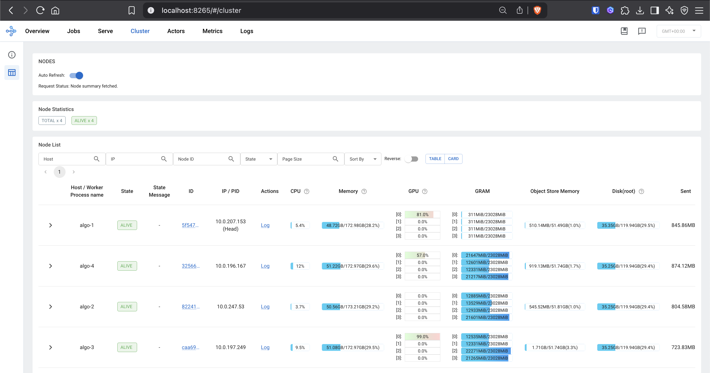
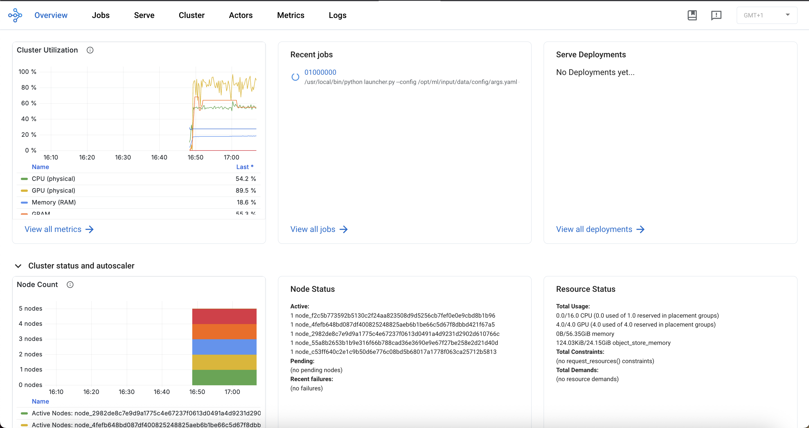

# Ray on Amazon SageMaker training jobs

This repository demonstrates how to use Ray for distributed data processing and model training within Amazon SageMaker training jobs.

## Table of Contents

- [Prerequisites](#prerequisites)
- [Project Structure](#project-structure)
- [Key Components](#key-components)
  - [Launcher](#launcher)
  - [Required Parameters and Environment Variables](#required-parameters-and-environment-variables)
    - [Parameter Reference](#parameter-reference)
    - [Environment Variables Reference](#environment-variables-reference)
  - [EFA / RDMA networking](#efa--rdma-networking)
  - [Script definition](#script-definition)
- [Examples](#examples)
- [Example Usage](#example-usage)
- [Ray Dashboard](#ray-dashboard)
- [Observability with Prometheus and Grafana](#observability-with-prometheus-and-grafana)
  - [Remote Write to an External Prometheus](#remote-write-to-an-external-prometheus)
    - [Amazon Managed Service for Prometheus (AMP)](#amazon-managed-service-for-prometheus-amp)
    - [Self-hosted Prometheus](#self-hosted-prometheus)
  - [(Optional) Provide Prometheus binary file](#optional-provide-prometheus-binary-file)
  - [(Optional) Embedded Prometheus and Grafana for isolated environments](#optional-embedded-prometheus-and-grafana-for-isolated-environments)
  - [Grafana Dashboards](#grafana-dashboards)

## Prerequisites

- AWS account with Amazon SageMaker AI access
- Ray 2.44+ (the pinned version is `ray[data,train,tune,serve]==2.56.1`). The Grafana dashboard reads Ray Train **V2** metrics (`ray_train_controller_state`, `ray_train_report_total_blocked_time_s`), which older releases do not export
- SageMaker Python SDK >=3.20.0 (the examples use the v3 `ModelTrainer` API from `sagemaker.train`)

## Project Structure

```
sample-ray-on-amazon-sagemaker-training-jobs/
├── scripts/
│    ├── launcher.py
│    └── requirements.txt
├── examples/
│    ├── ray-remote/
│    │    ├── pytorch/                    # Homogeneous cluster
│    │    │    ├── notebook.ipynb
│    │    │    └── scripts/
│    │    │         ├── train.py
│    │    │         ├── model.py
│    │    │         └── requirements.txt
│    │    └── pytorch-heterogeneous/      # Heterogeneous cluster
│    │         ├── notebook.ipynb
│    │         └── scripts/
│    │              ├── train.py
│    │              ├── model.py
│    │              └── requirements.txt
│    ├── ray-data/
│    │    ├── pytorch/
│    │    │    ├── notebook.ipynb
│    │    │    └── scripts/
│    │    │         ├── inference.py
│    │    │         ├── model.py
│    │    │         └── requirements.txt
│    │    └── pytorch-heterogeneous/
│    │         ├── notebook.ipynb
│    │         └── scripts/
│    │              ├── inference.py
│    │              ├── model.py
│    │              └── requirements.txt
│    ├── ray-tune/
│    │    ├── pytorch/
│    │    │    ├── notebook.ipynb
│    │    │    └── scripts/
│    │    │         ├── tune.py
│    │    │         ├── model.py
│    │    │         └── requirements.txt
│    │    └── pytorch-heterogeneous/
│    │         ├── notebook.ipynb
│    │         └── scripts/
│    │              ├── tune.py
│    │              ├── model.py
│    │              └── requirements.txt
│    └── ray-torchtrainer/
│         ├── huggingface/
│         │    ├── notebook.ipynb
│         │    └── scripts/
│         │         ├── train_ray.py
│         │         └── requirements.txt
│         └── huggingface-heterogeneous/
│              ├── notebook.ipynb
│              └── scripts/
│                   ├── train_ray.py
│                   └── requirements.txt
├── grafana-dashboards/
│    └── ray_sagemaker_training_dashboard.json
└── images/
```

## Key Components

### Launcher

The `launcher.py` script serves as the entry point for SageMaker training jobs and handles:

- Setting up the Ray environment for both single-node and multi-node scenarios
- Supporting both homogeneous and heterogeneous instance group clusters
- Coordinating between head and worker nodes in a distributed setup
- Configuring EFA/RDMA networking for supported GPU instances
- Optionally launching Prometheus for metrics collection
- Optionally launching an embedded Grafana server for the Ray Dashboard metrics tab
- Executing the appropriate user script (Python `.py` or Bash `.sh`)
- Graceful shutdown with configurable wait period

#### Important Notes

**The `launcher.py` script is not intended to be modified by users.** This script serves as a universal entrypoint for SageMaker training jobs and handles Ray cluster setup, coordination between nodes, and execution of your custom scripts.

**Ray Autoscaler is not supported.** SageMaker training jobs use a fixed number of instances defined at job creation time. The Ray cluster size is determined by the SageMaker cluster configuration (`instance_count` or `instance_groups`), and cannot be dynamically scaled during execution. All nodes are provisioned at the start of the job and remain available until the job completes.

**IAM permissions used by the launcher itself.** Beyond the usual SageMaker training permissions, the execution role should allow:

- `ec2:DescribeInstanceTypes` — the launcher queries it at startup to discover which instance types support EFA. Without it the call fails and the launcher silently falls back to a static, hard-coded list, which may not include newer instance types.
- `s3:GetObject` on the bucket holding your Prometheus tarball, if you pass one via `--prometheus-path` as an InputData channel.

You should:

- Write your own Ray scripts for data processing or model training
- Use `launcher.py` as the entrypoint in your SageMaker jobs
- Make sure your `requirements.txt` or your container includes `ray[data,train,tune,serve]` and `sagemaker`
- Specify the custom script path using the `-e` / `--entrypoint` argument

### Required Parameters and Environment Variables

The `launcher.py` script requires specific parameters to execute your custom training scripts. You can configure these through command line arguments or environment variables.

### Parameter Reference

| Argument                | Type   | Required | Default          | Env-var fallback      | Description                                                                                                  |
| ----------------------- | ------ | -------- | ---------------- | --------------------- | ------------------------------------------------------------------------------------------------------------ |
| `-e`, `--entrypoint`    | string | Yes      | None             | none\*\*              | Path to your script (e.g., `train.py`, `training/train.py`, `run.sh`)                                        |
| `--head-instance-group` | string | Yes\*    | None             | `head_instance_group` | Instance group name for Ray head node (heterogeneous clusters only)                                          |
| `--head-num-cpus`       | int    | No       | Instance default | `head_num_cpus`       | Number of CPUs reserved for head node                                                                        |
| `--head-num-gpus`       | int    | No       | Instance default | `head_num_gpus`       | Number of GPUs reserved for head node                                                                        |
| `--include-dashboard`   | bool   | No       | True             | **none**              | Enable the Ray Dashboard UI. Independent of metrics — see the note below                                     |
| `--launch-prometheus`   | bool   | No       | True             | `launch_prometheus`   | Launch local Prometheus on the head node. Internet connectivity required unless `--prometheus-path` is given |
| `--prometheus-path`     | string | No       | None             | `prometheus_path`     | Path to prometheus binary if provided as InputData                                                           |
| `--grafana-path`        | string | No       | None             | `grafana_path`        | Path to the Grafana archive if provided as InputData. Starts an embedded Grafana on the head node            |
| `--grafana-port`        | int    | No       | 3000             | `grafana_port`        | Port used by the embedded Grafana server                                                                     |
| `--wait-shutdown`       | int    | No       | None             | `wait_shutdown`       | Seconds to wait before Ray shutdown                                                                          |

\*Required only for heterogeneous clusters

\*\*`--entrypoint` itself has no env-var fallback, but it is equivalent to setting the `source_dir` and `entry_script` environment variables directly: `-e training/train.py` is the same as `source_dir=training`, `entry_script=train.py`.

### Environment Variables Reference

Most parameters above can also be set as environment variables via the `environment` dict in your ModelTrainer or Estimator configuration — see the "Env-var fallback" column for the exact name. Environment variables are used as fallback when the corresponding command line argument is not provided, **except** `launch_prometheus`, which currently takes precedence over `--launch-prometheus`. `--include-dashboard` can only be set on the command line.

| Variable                  | Type   | Required | Description                                                                                                                                                                                                |
| ------------------------- | ------ | -------- | ---------------------------------------------------------------------------------------------------------------------------------------------------------------------------------------------------------- |
| `head_instance_group`     | string | No       | Alternative way to set head instance group name (heterogeneous clusters only)                                                                                                                              |
| `head_num_cpus`           | int    | No       | Alternative way to set number of CPUs reserved for head node                                                                                                                                               |
| `head_num_gpus`           | int    | No       | Alternative way to set number of GPUs reserved for head node                                                                                                                                               |
| `launch_prometheus`       | bool   | No       | Alternative way to enable/disable local Prometheus on the head node (default: true). Internet connectivity required                                                                                        |
| `prometheus_path`         | string | No       | Path to prometheus binary if provided as InputData                                                                                                                                                         |
| `grafana_path`            | string | No       | Path to the Grafana archive if provided as InputData. Starts an embedded Grafana on the head node                                                                                                          |
| `grafana_port`            | int    | No       | Alternative way to set the port of the embedded Grafana server (default: `3000`). Cannot be `6379`, `8080`, `8265` or `9090`                                                                               |
| `grafana_dashboard_path`  | string | No       | Path to `ray_sagemaker_training_dashboard.json` inside the container, provisioned into the embedded Grafana. Auto-detected in `source_dir` / a `grafana-dashboards/` subfolder when not set                |
| `wait_shutdown`           | int    | No       | Alternative way to set shutdown wait time                                                                                                                                                                  |
| `RAY_PROMETHEUS_HOST`     | string | No       | Prometheus host URL. When set to a remote URL (not localhost), enables remote_write from local Prometheus to the remote endpoint. For AMP URLs, SigV4 auth is automatic                                    |
| `RAY_PROMETHEUS_NAME`     | string | No       | Prometheus data source name in Grafana (default: `Prometheus`). Used by the Ray Dashboard for Grafana integration                                                                                          |
| `RAY_GRAFANA_HOST`        | string | No       | Grafana server URL. Used by the Ray Dashboard for server-side API calls, and as the default for `RAY_GRAFANA_IFRAME_HOST`                                                                                  |
| `RAY_GRAFANA_IFRAME_HOST` | string | No       | Grafana URL the **browser** uses to load embedded panels. Set this when the Dashboard reaches Grafana at a different address than your browser does (e.g. port-forwarding). Defaults to `RAY_GRAFANA_HOST` |
| `RAY_PROMETHEUS_USERNAME` | string | No       | Username for basic auth when remote writing to a self-hosted Prometheus server                                                                                                                             |
| `RAY_PROMETHEUS_PASSWORD` | string | No       | Password for basic auth when remote writing to a self-hosted Prometheus server                                                                                                                             |
| `FI_PROVIDER`             | string | No       | libfabric provider for EFA networking. Leave unset to let the launcher autodetect (see [EFA / RDMA networking](#efa--rdma-networking)). Set explicitly to override                                         |
| `FI_EFA_USE_DEVICE_RDMA`  | string | No       | Enable EFA's RDMA transport (`"1"`). Leave unset for autodetection; set explicitly to override                                                                                                             |
| `RDMAV_FORK_SAFE`         | string | No       | Make RDMA fork-safe (`"1"`). Leave unset for autodetection; set explicitly to override                                                                                                                     |

### EFA / RDMA networking

EFA (Elastic Fabric Adapter) accelerates inter-node communication on supported GPU
instances. **By default you do not need to configure anything** — the launcher detects
whether an EFA device is actually attached to each node and enables it only when present:

- If the instance type is EFA-capable **and** an EFA device is detected, the launcher sets
  `FI_PROVIDER=efa` (and, on RDMA-capable types such as p4d/p4de/trn1,
  `FI_EFA_USE_DEVICE_RDMA=1` and `RDMAV_FORK_SAFE=1`).
- If no EFA device is present (for example a coordinator-only head node), the launcher leaves
  these unset so libfabric is never pointed at a device that does not exist.

Detection uses `fi_info -p efa` (with a sysfs fallback). This per-device check is more robust
than keying off the instance type alone, because an EFA-capable instance does not always have
an EFA device attached for every job.

**Overriding the autodetection.** Any of these variables set in the ModelTrainer `environment`
dict always takes precedence over autodetection:

```python
model_trainer = ModelTrainer(
    ...
    environment={
        "FI_PROVIDER": "efa",   # force EFA on, or set "tcp" to force it off
    },
)
```

> **Note:** Forcing `FI_PROVIDER=efa` applies it to every node, including any without an EFA
> device. This is harmless for communication-light workloads (e.g. `ray.data` batch inference)
> but can cause libfabric/NCCL initialization errors for collective workloads (e.g. distributed
> training) on a node where EFA is not actually attached. Setting `FI_PROVIDER=tcp` is a safe
> way to disable EFA entirely (e.g. for debugging).

### Script definition

The entry script can be a Python (`.py`) or Bash (`.sh`) file.

Python entry scripts must contain a `__main__` block:

```python
import ray

# Your Ray code here

if __name__ == "__main__":
    # This block will be executed by the launcher
    pass
```

Bash entry scripts are executed directly via `bash <script_path> [args...]`. Any arguments the launcher does not recognize are passed through to the script as positional arguments (`"$@"`), and the script's output is streamed to the job logs while it runs. For example, `python launcher.py -e run.sh --epochs 10` runs `bash run.sh --epochs 10`.

Python entry scripts run inside the launcher process, so they can read the same arguments from `sys.argv` (for example with `argparse`'s `parse_known_args()`).

## Examples

The repository includes 8 example notebooks covering 4 Ray patterns, each with both homogeneous and heterogeneous cluster configurations.

Each notebook copies `launcher.py` into its local `scripts/` directory and launches a SageMaker training job using the PySDK v3 `ModelTrainer` API.

| Pattern              | Description                                                                                                                              | Homogeneous         | Heterogeneous                                           |
| -------------------- | ---------------------------------------------------------------------------------------------------------------------------------------- | ------------------- | ------------------------------------------------------- |
| **ray-remote**       | Distributed task-level parallelism using `@ray.remote` for data cleaning and PyTorch model training (sentiment classification)           | 1x `ml.m5.2xlarge`  | 1x `ml.t3.large` (head) + 2x `ml.m5.2xlarge` (workers)  |
| **ray-data**         | Batch inference with `ray.data` using ResNet152 on Imagenette dataset                                                                    | 1x `ml.m5.2xlarge`  | 1x `ml.t3.large` (head) + 2x `ml.m5.2xlarge` (workers)  |
| **ray-tune**         | Hyperparameter tuning with `ray.tune` and ASHA scheduler on CIFAR-10                                                                     | 1x `ml.m5.2xlarge`  | 1x `ml.t3.large` (head) + 2x `ml.m5.2xlarge` (workers)  |
| **ray-torchtrainer** | Distributed LLM fine-tuning (LoRA/QLoRA) with `ray.train.torch.TorchTrainer`, HuggingFace Transformers, and optional MLflow/W&B tracking | 1x `ml.g5.12xlarge` | 1x `ml.t3.2xlarge` (head) + 4x `ml.g5.xlarge` (workers) |

In heterogeneous configurations, the head node is configured as coordinator-only (`head_num_cpus=0`, `head_num_gpus=0`), while the worker instance group handles computation.

## Example Usage

The launcher script has been designed to be flexible and dynamic, allowing you to specify any entry script through arguments or environment variables, rather than hardcoded imports.

### Entrypoint Argument

The launcher uses one argument:

- `-e` / `--entrypoint`: Path to the script to execute (Python files must contain `if __name__ == "__main__":` block)

### Usage Examples

See the content of [examples](./examples)

#### 1. Using SageMaker ModelTrainer (Recommended)

```python
from sagemaker.train.configs import (
    Compute,
    OutputDataConfig,
    SourceCode,
    StoppingCondition,
)
from sagemaker.train.model_trainer import ModelTrainer

args = [
    "-e",
    "train.py",
    "--epochs",
    "25",
    "--learning_rate",
    "0.001",
    "--batch_size",
    "100",
]

# Define the source code configuration
source_code = SourceCode(
    source_dir="./scripts",
    requirements="requirements.txt",
    command=f"python launcher.py {' '.join(args)}",
)

# Define compute configuration
compute_configs = Compute(
    instance_type="ml.m5.2xlarge",
    instance_count=1,
    keep_alive_period_in_seconds=0,
)

# Define training job name and output path
job_name = "train-ray-training"
output_path = f"s3://{bucket_name}/{job_name}"

# Create the ModelTrainer
model_trainer = ModelTrainer(
    training_image=image_uri,
    source_code=source_code,
    base_job_name=job_name,
    compute=compute_configs,
    stopping_condition=StoppingCondition(max_runtime_in_seconds=18000),
    output_data_config=OutputDataConfig(s3_output_path=output_path),
    role=role,
)

...

# Start the training job
model_trainer.train(input_data_config=[train_input], wait=False)
```

#### 2. Heterogeneous Cluster with SageMaker ModelTrainer

```python
from sagemaker.train.configs import (
    Compute,
    InstanceGroup,
    OutputDataConfig,
    RemoteDebugConfig,
    SourceCode,
    StoppingCondition,
)
from sagemaker.train.model_trainer import ModelTrainer

# Define instance groups with different instance types
instance_groups = [
    InstanceGroup(
        instance_group_name="head-instance-group",
        instance_type="ml.t3.large",       # CPU-only for coordination
        instance_count=1,
    ),
    InstanceGroup(
        instance_group_name="worker-instance-group-1",
        instance_type="ml.m5.2xlarge",     # Compute instances for training
        instance_count=2,
    ),
]

args = [
    "--entrypoint",
    "train.py",
    "--epochs",
    "100",
    "--learning_rate",
    "0.001",
    "--batch_size",
    "100",
]

# Define the source code configuration
source_code = SourceCode(
    source_dir="./scripts",
    requirements="requirements.txt",
    command=f"python launcher.py {' '.join(args)}",
)

# Define compute with instance groups
compute_configs = Compute(
    instance_groups=instance_groups,
    keep_alive_period_in_seconds=0,
)

# Define training job name and output path
job_name = "train-ray-training"
output_path = f"s3://{bucket_name}/{job_name}"

# Create the ModelTrainer
model_trainer = ModelTrainer(
    training_image=image_uri,
    source_code=source_code,
    base_job_name=job_name,
    compute=compute_configs,
    stopping_condition=StoppingCondition(max_runtime_in_seconds=18000),
    output_data_config=OutputDataConfig(
        s3_output_path=output_path, compression_type="NONE"
    ),
    environment={
        "head_instance_group": "head-instance-group",  # Specify which group is the head
        "head_num_cpus": "0",   # Head node as coordinator only
        "head_num_gpus": "0",   # Head node as coordinator only
    },
    role=role,
).with_remote_debug_config(RemoteDebugConfig(enable_remote_debug=True))

...

# Start the training job
model_trainer.train(input_data_config=[train_input], wait=False)
```

**Key environment variables for heterogeneous clusters:**

- `head_instance_group`: Specifies which instance group should act as the Ray head node
- `head_num_cpus`: Number of CPUs to reserve for the head node (set to `"0"` for coordinator-only mode)
- `head_num_gpus`: Number of GPUs to reserve for the head node (set to `"0"` for coordinator-only mode)

### Entry Script Requirements

Your entry scripts must follow this pattern:

```python
# my_script.py
import ray

# Your Ray code here

if __name__ == "__main__":
    # This block will be executed by the launcher
    # Ray is already initialized — use ray.cluster_resources(), @ray.remote, etc.
    pass
```

## Ray Dashboard

For accessing the Ray Dashboard during the execution of Ray workload, we can leverage the native feature to access [SageMaker training jobs by using AWS System Manager (SSM)](https://docs.aws.amazon.com/sagemaker/latest/dg/train-remote-debugging.html)

### Step 1: Setup IAM Permissions:

Please refer to the official [AWS Documentation](https://docs.aws.amazon.com/sagemaker/latest/dg/train-remote-debugging.html#train-remote-debugging-iam)

### Step 2:

Enable remote debugging for SageMaker training jobs:

```python
from sagemaker.train.configs import (
    CheckpointConfig,
    Compute,
    OutputDataConfig,
    RemoteDebugConfig,
    SourceCode,
    StoppingCondition,
)
from sagemaker.train.model_trainer import ModelTrainer

# Define the script to be run
source_code = SourceCode(
    source_dir="./scripts",
    requirements="requirements.txt",
    command="python launcher.py --entrypoint train_ray.py",
)

# Define the compute
compute_configs = Compute(
    instance_type=instance_type,
    instance_count=instance_count,
    keep_alive_period_in_seconds=0,
)

...

# Define the ModelTrainer
model_trainer = ModelTrainer(
    training_image=image_uri,
    source_code=source_code,
    base_job_name=job_name,
    compute=compute_configs,
    stopping_condition=StoppingCondition(max_runtime_in_seconds=18000),
    output_data_config=OutputDataConfig(s3_output_path=output_path),
    checkpoint_config=CheckpointConfig(
        s3_uri=output_path + "/checkpoint", local_path="/opt/ml/checkpoints"
    ),
    role=role,
).with_remote_debug_config(RemoteDebugConfig(enable_remote_debug=True))
```

### Step 3:

Access the training container, by starting a Port Forwarding to the port `8265` (Default Ray Dashboard port) with the following command:

```
aws ssm start-session --target sagemaker-training-job:<training-job-name>_algo-<n> \
--region <aws_region> \
--document-name AWS-StartPortForwardingSession \
--parameters '{"portNumber":["8265"],"localPortNumber":["8265"]}'
```

In a multi-node cluster, you can check the head node by investigating the CloudWatch logs:

```
2025-06-25 08:47:18,755 - __main__ - INFO - Found multiple hosts, initializing Ray as a multi-node cluster
2025-06-25 08:47:18,755 - __main__ - INFO - Head node: algo-1, Current host: algo-3
```

### Step 4:

Access the Ray Dashboard from your browser: `localhost:8265`:



## Observability with Prometheus and Grafana

Prometheus runs locally on the head node by default, collecting Ray system metrics (CPU, GPU, memory, disk, network, and Ray-specific metrics). Metrics are visible in the Ray Dashboard's metrics tab without any additional configuration.

> **Note:** Internet connectivity on the SageMaker cluster is required for Prometheus to be downloaded automatically. See [Provide Prometheus binary file](#optional-provide-prometheus-binary-file) for offline environments.

### Remote Write to an External Prometheus

You can forward metrics to an external Prometheus-compatible endpoint using `remote_write`. This is useful for persisting metrics beyond the training job lifetime or for centralized monitoring with Grafana.

Set `RAY_PROMETHEUS_HOST` to the remote Prometheus base URL. The launcher will:

1. Keep the local Prometheus running and the Ray Dashboard connected to it (`http://127.0.0.1:9090`)
2. Automatically inject a `remote_write` section into the local Prometheus configuration
3. Build the remote write URL from the provided host: `/api/v1/remote_write` is appended for AMP endpoints, `/api/v1/write` for any other (self-hosted) Prometheus

#### Amazon Managed Service for Prometheus (AMP)

When `RAY_PROMETHEUS_HOST` points to an AMP endpoint (`aps-workspaces.{region}.amazonaws.com`), SigV4 authentication is automatically configured using the IAM execution role attached to the SageMaker training job.

```python
model_trainer = ModelTrainer(
    ...
    source_code=source_code,
    environment={
        "RAY_PROMETHEUS_HOST": "https://aps-workspaces.us-east-1.amazonaws.com/workspaces/ws-xxxxx",
    },
    ...
)
```

**IAM Requirements:** The SageMaker execution role must have the following permissions:

```json
{
  "Version": "2012-10-17",
  "Statement": [
    {
      "Effect": "Allow",
      "Action": [
        "aps:RemoteWrite",
        "aps:GetSeries",
        "aps:GetLabels",
        "aps:GetMetricMetadata"
      ],
      "Resource": "*"
    }
  ]
}
```

#### Self-hosted Prometheus

For a self-hosted Prometheus server (e.g., on EC2), set `RAY_PROMETHEUS_HOST` to the server URL. The remote server must have `--web.enable-remote-write-receiver` enabled (Prometheus v2.33+).

```python
model_trainer = ModelTrainer(
    ...
    source_code=source_code,
    environment={
        "RAY_PROMETHEUS_HOST": "https://my-prometheus-server.example.com",
    },
    ...
)
```

If the remote Prometheus requires basic authentication, pass credentials via environment variables:

```python
model_trainer = ModelTrainer(
    ...
    source_code=source_code,
    environment={
        "RAY_PROMETHEUS_HOST": "https://my-prometheus-server.example.com",
        "RAY_PROMETHEUS_USERNAME": "myuser",
        "RAY_PROMETHEUS_PASSWORD": "mypassword",
    },
    ...
)
```

> **Note:** Make sure the SageMaker training job has network connectivity to the remote endpoint (e.g., via VPC configuration).

### (Optional) Provide Prometheus binary file

By default, Ray downloads the Prometheus binary from the internet. In environments with limited internet connectivity, you can pre-download the binary, upload it to S3, and provide it as a training input.

> **Warning:** If the SageMaker training job does not have internet access (e.g., running in a private VPC without a NAT gateway), Prometheus will fail to download and metrics collection will not work. In this case, you **must** provide the binary file as described below.

**Step 1:** Download the Prometheus binary:

```bash
wget https://github.com/prometheus/prometheus/releases/download/v3.13.1/prometheus-3.13.1.linux-amd64.tar.gz
```

**Step 2:** Upload to S3 and configure as training input:

```python
from sagemaker.train.configs import InputData, S3DataSource

prometheus_input = InputData(
    channel_name="prometheus",
    data_source=S3DataSource(
        s3_data_type="S3Prefix",
        s3_uri="s3://<bucket>/path/to/prometheus-3.13.1.linux-amd64.tar.gz",
        s3_data_distribution_type="FullyReplicated",
    ),
)
```

**Step 3:** Pass the `--prometheus-path` argument:

```python
source_code = SourceCode(
    source_dir="./scripts",
    requirements="requirements.txt",
    command="python launcher.py --entrypoint train_ray.py --prometheus-path /opt/ml/input/data/prometheus/prometheus-3.13.1.linux-amd64.tar.gz",
)
```

### (Optional) Embedded Prometheus and Grafana for isolated environments

The options above assume the training job can reach a metrics backend: AMP, a self-hosted
Prometheus, or a Grafana instance. When the cluster runs in an isolated VPC with no route to any
of them, both Prometheus **and** Grafana can run inside the training container itself, on the head
node. Prometheus scrapes the Ray metrics over loopback and the embedded Grafana renders them,
including in the **Metrics** tab of the Ray Dashboard.

Pass the Grafana archive with `--grafana-path` (alongside `--prometheus-path`) and the launcher:

1. Extracts the archive into `/opt/ml/code` (on the head node only — workers never run Grafana)
2. Provisions Grafana from the configuration the Ray Dashboard generates in
   `/tmp/ray/session_latest/metrics/grafana` — the Prometheus datasource and the Ray dashboards,
   with the UIDs the Metrics tab embeds, so no dashboard has to be imported manually
3. Also provisions this repository's `ray_sagemaker_training_dashboard.json` into a **SageMaker**
   folder, when it can be found in the container — ship it in your `source_dir`, or point the
   `grafana_dashboard_path` environment variable at it. If it is absent, only Ray's own
   dashboards are provisioned
4. Starts `bin/grafana server` on port `3000` (`--grafana-port` to change it) with anonymous
   `Viewer` access and `allow_embedding` enabled, which the Dashboard iframes require
5. Sets `RAY_GRAFANA_HOST` to `http://127.0.0.1:<port>` for the Dashboard backend and
   `RAY_GRAFANA_IFRAME_HOST` to `http://localhost:<port>` for the browser. Values you provide
   explicitly always take precedence
6. Stops Grafana when the job shuts down

Failures are logged and never fail the training job: Prometheus keeps collecting metrics even if
Grafana does not come up.

#### Choosing a Prometheus and a Grafana

Prometheus, Grafana and the Dashboard are **three independent switches**. `--include-dashboard`
controls only the Ray Dashboard UI: metrics are collected whenever `--launch-prometheus` is on, and
the embedded Grafana runs whenever `--grafana-path` is given, with or without the UI. Grafana always
reads whatever `RAY_PROMETHEUS_HOST` resolves to, so the combinations behave as follows:

| Prometheus                                               | no Grafana         | external Grafana      | embedded Grafana     |
| -------------------------------------------------------- | ------------------ | --------------------- | -------------------- |
| local, Ray downloads the binary (needs egress)           | ✅                 | ✅                    | ✅ reads local       |
| local, `--prometheus-path` (offline)                     | ✅                 | ✅                    | ✅ **fully offline** |
| local **+ remote_write** to AMP / self-hosted            | ✅                 | ✅ the AMP flow above | ✅ reads local       |
| `launch_prometheus=false` + remote `RAY_PROMETHEUS_HOST` | ⚠️ nothing scrapes | ✅                    | ✅ AMP via SigV4     |
| `launch_prometheus=false`, no host                       | ✅ no metrics      | —                     | ❌ empty panels      |

Notes:

- `launch_prometheus=true` is what actually **collects** metrics — the local Prometheus is the only
  thing that scrapes the Ray nodes. Remote write **persists** them; Grafana **renders** them.
- With `launch_prometheus=false` the `instance_type` and `sagemaker_training_job_name` labels are
  not injected, so the `InstanceType` and `TrainingJobName` dashboard variables stay empty.
- **Metrics without the Dashboard is supported.** Ray always exposes its per-node exporter on
  `8080` (it lives in the node agent, not the Dashboard UI). Ray only writes a Prometheus scrape
  config when the Dashboard runs, so with `--include-dashboard false` the launcher generates the
  scrape targets itself from the cluster hosts. This makes "no UI, ship metrics to AMP" a valid
  setup — useful for locked-down environments. Pair it with `--prometheus-path` if the job has no
  egress.
- With `--include-dashboard false` the embedded Grafana still starts, but there is no Metrics tab to
  embed its panels in, so reach it directly on its port via SSM port forwarding.
- **AMP works with either Grafana.** Amazon Managed Grafana automates SigV4 for you. For the
  embedded Grafana the launcher does it: any provisioned datasource whose URL is an AMP workspace
  gets `sigV4Auth` plus the region, and Grafana is started with `GF_AUTH_SIGV4_AUTH_ENABLED` and
  `AWS_SDK_LOAD_CONFIG` (both required — Grafana ships with SigV4 support off). Queries are then
  signed with the execution role, which needs the AMP **read** actions, and the job must be able
  to reach AMP (e.g. through a VPC endpoint).
- Setting `RAY_GRAFANA_HOST` to an external Grafana **disables** the embedded one (it would be a
  process nobody queries); a loopback value is treated as pointing at the embedded Grafana itself.
- `--grafana-port` may not use `6379`, `8080`, `8265` or `9090` — those belong to Ray and the local
  Prometheus, and the launcher falls back to `3000`.
- Do not set both an AMP `RAY_PROMETHEUS_HOST` and `RAY_PROMETHEUS_USERNAME`/`PASSWORD`: AMP
  authenticates with SigV4, so the credentials are ignored (with a warning).

**Step 1:** Download the Prometheus and Grafana archives:

```bash
wget https://github.com/prometheus/prometheus/releases/download/v3.13.1/prometheus-3.13.1.linux-amd64.tar.gz
wget https://dl.grafana.com/oss/release/grafana-12.0.1.linux-amd64.tar.gz
```

**Step 2:** Upload both to S3 and configure them as training inputs:

```python
from sagemaker.train.configs import InputData, S3DataSource

prometheus_input = InputData(
    channel_name="prometheus",
    data_source=S3DataSource(
        s3_data_type="S3Prefix",
        s3_uri="s3://<bucket>/path/to/prometheus-3.13.1.linux-amd64.tar.gz",
        s3_data_distribution_type="FullyReplicated",
    ),
)

grafana_input = InputData(
    channel_name="grafana",
    data_source=S3DataSource(
        s3_data_type="S3Prefix",
        s3_uri="s3://<bucket>/path/to/grafana-12.0.1.linux-amd64.tar.gz",
        s3_data_distribution_type="FullyReplicated",
    ),
)
```

**Step 3:** Pass both paths to the launcher:

```python
source_code = SourceCode(
    source_dir="./scripts",
    requirements="requirements.txt",
    command=(
        "python launcher.py --entrypoint train_ray.py"
        " --prometheus-path /opt/ml/input/data/prometheus/prometheus-3.13.1.linux-amd64.tar.gz"
        " --grafana-path /opt/ml/input/data/grafana/grafana-12.0.1.linux-amd64.tar.gz"
    ),
)
```

**Step 4:** Forward both the Dashboard and the Grafana port, in two separate sessions:

```bash
aws ssm start-session --target sagemaker-training-job:<training-job-name>_algo-1 \
--region <aws_region> \
--document-name AWS-StartPortForwardingSession \
--parameters '{"portNumber":["8265"],"localPortNumber":["8265"]}'

aws ssm start-session --target sagemaker-training-job:<training-job-name>_algo-1 \
--region <aws_region> \
--document-name AWS-StartPortForwardingSession \
--parameters '{"portNumber":["3000"],"localPortNumber":["3000"]}'
```

Open `localhost:8265` and the Metrics tab renders the Grafana panels; Grafana itself is available
on `localhost:3000`:



> **Note:** Both processes live and die with the training job, so the metrics are gone once the job
> ends. To keep them, combine this setup with
> [remote write](#remote-write-to-an-external-prometheus) whenever an external Prometheus is
> reachable.

### Grafana Dashboards

This repository includes a pre-built Ray Grafana dashboard in the [`grafana-dashboards/`](./grafana-dashboards) directory:

| Dashboard                               | Description                                                                                                                                                                                |
| --------------------------------------- | ------------------------------------------------------------------------------------------------------------------------------------------------------------------------------------------ |
| `ray_sagemaker_training_dashboard.json` | Combined cluster and Ray Train metrics: CPU/GPU utilization, memory, GRAM, disk, network, tasks and actors, logical resources, and Ray Train controller/worker timings (7 rows, 25 panels) |

The dashboard exposes template variables to narrow down what you are looking at: `SessionName`, `Instance`, `RayNodeType`, `TrainRunName`, `TrainRunId`, `TrainWorkerWorldRank`, `TrainWorkerActorId`, plus two SageMaker-specific ones — `TrainingJobName` and `InstanceType`. The last two are driven by the `sagemaker_training_job_name` and `instance_type` labels that the launcher adds to the Prometheus scrape configuration automatically, so filtering by training job or by instance type works with no extra setup. `InstanceType` is what makes heterogeneous clusters readable, since each node reports its own type.

> **Note:** the `Node Count` panel and the "PENDING" series of the `Logical CPUs/GPUs Usage` panels read `autoscaler_*` metrics. Because the Ray Autoscaler is not used on SageMaker (the cluster is fixed at job creation), those series stay empty or flat. This is expected, not a broken dashboard.

#### Importing Dashboards

1. In Grafana, go to **Dashboards** → **New** → **Import**
2. Upload the JSON file from the `grafana-dashboards/` directory
3. Select your Prometheus data source when prompted
4. Click **Import**

#### Connecting Grafana to Amazon Managed Service for Prometheus

When using AMP as the metrics backend, configure your Grafana instance (Amazon Managed Grafana or self-hosted) to read from AMP:

1. Add a new **Amazon Managed Service for Prometheus** data source (or **Prometheus** with SigV4 auth)
2. Set the **Prometheus server URL** to your AMP workspace URL (e.g., `https://aps-workspaces.us-east-1.amazonaws.com/workspaces/ws-xxxxx`)
3. Configure **SigV4 authentication** with the appropriate IAM role
4. Set the **Scrape interval** to `10s` to match the Prometheus configuration
5. Click **Save & test** to verify connectivity

> **Note:** Grafana iframe embedding in the Ray Dashboard requires `allow_embedding = true` and anonymous auth in `grafana.ini`, which is only available with self-hosted Grafana. AWS Managed Grafana does not expose these settings. Use Managed Grafana dashboards directly in a separate browser tab, or run the [embedded Grafana](#optional-embedded-prometheus-and-grafana-for-isolated-environments) on the head node, which sets both options and provisions these dashboards automatically.

## Authors

[Bruno Pistone](https://it.linkedin.com/in/bpistone) - Sr. WW Gen AI/ML Specialist Solutions Architect - Amazon SageMaker AI

[Giuseppe A. Porcelli](https://it.linkedin.com/in/giuporcelli) - Principal, ML Specialist Solutions Architect - Amazon SageMaker AI


